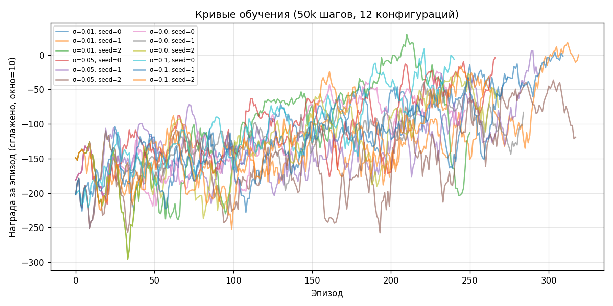
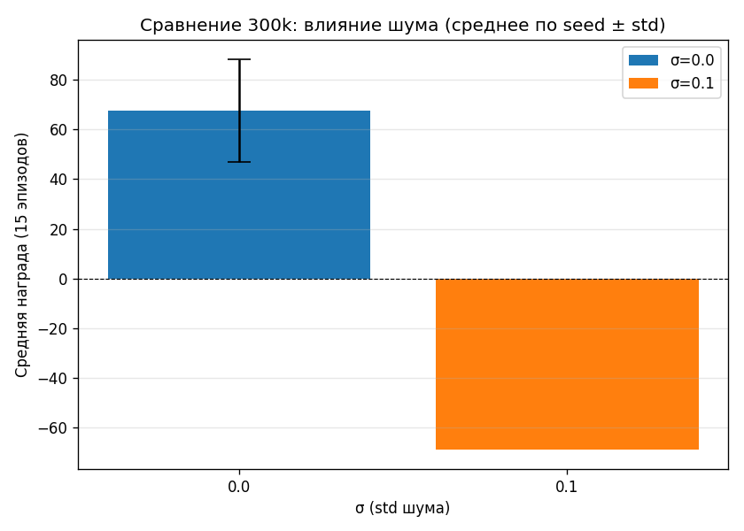
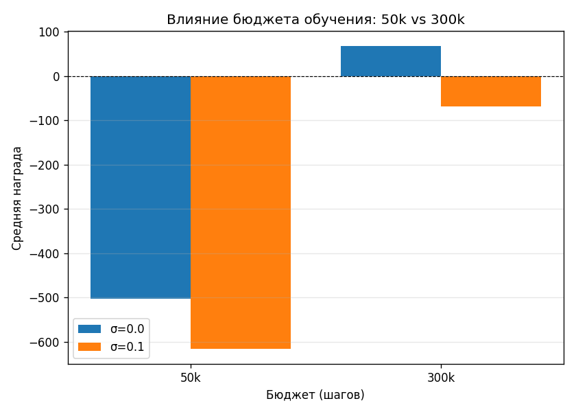

# Влияние шума в наблюдениях на качество и устойчивость PPO в LunarLander

## 1. Исследовательский вопрос

Как шум в наблюдениях влияет на качество и устойчивость PPO в среде LunarLander?

## 2. Гипотеза

При σ ≤ 0.05 качество почти не падает; при σ ≥ 0.1 — заметно снижается.

Обоснование: PPO учится на «чистых» наблюдениях; небольшой шум сеть
может «переварить», большой — сбивает.

## 3. Среда и алгоритм

- Среда: LunarLander-v3 (Gymnasium)
- Алгоритм: PPO (Stable-Baselines3, MlpPolicy)
- Гиперпараметры: n_steps=2048, batch_size=64, learning_rate=3e-4, gamma=0.99

## 4. Условия сравнения

| Условие | σ (std шума) |
|---|---|
| Базовое | 0.0 |
| Экспериментальное 1 | 0.01 |
| Экспериментальное 2 | 0.05 |
| Экспериментальное 3 | 0.1 |

Одинаково: архитектура, гиперпараметры, бюджет (100 000 шагов),
seed ∈ {0, 1, 2} (3 повтора на условие).

## 5. Метрика

Средняя награда на 15 эпизодах **без обучения** (после тренировки),
усреднённая по seed. Также — кривая обучения (награда по эпизодам).

## 6. Код и запуск

### Установка

```bash
pip install -r requirements.txt
```

### Обучение 50k (12 конфигураций последовательно)

```bash
python run_50k.py
```

### Обучение 300k (3 конфигурации)

```bash
python run_300k.py
```

### Оценка

```bash
python evaluate.py
python evaluate_300k.py
```

### Графики

```bash
python plot_results.py
```

### Видео

```bash
python rec_video.py
```

## 7. Результаты

### 7.1. Ограничение бюджета: 50k шагов недостаточно

На бюджете **50 000 шагов** агент **не успевает обучиться**: средние награды
отрицательные (−260 … −1035), разброс по seed огромный (например, σ=0:
−341 и −819). На этом бюджете **шум не проявляется** — разброс по seed
доминирует над эффектом шума.



### 7.2. Основной результат: 300k шагов

На бюджете **300 000 шагов** агент **обучается** и шум **чётко проявляется**:

| σ (std шума) | seed | Средняя награда (15 эпизодов) |
|---|---|---|
| 0.0 | 0 | **+82.2** ± 109.6 |
| 0.0 | 1 | **+53.1** ± 115.1 |
| 0.1 | 0 | **−68.8** ± 38.3 |



**Среднее по σ=0** (два seed): **+67.6**. **σ=0.1**: **−68.8**.
Разница **≈ 136 пунктов** — шум **сильно** снижает качество.

### 7.3. Влияние бюджета



На 50k агент **не обучается** (награды отрицательные при любом σ).
На 300k — **обучается**, и **эффект шума становится видимым**.

### 7.4. Видео поведения агента

Лучший эпизод (σ=0, seed=0, 300k): награда **+185.6**.
Видео: `results_300k/video/rl-video-episode-2.mp4`.

## 8. Анализ

### 8.1. Подтвердилась ли гипотеза?

**Частично.** Гипотеза: «при σ ≤ 0.05 качество почти не падает; при σ ≥ 0.1 — заметно снижается».

- На **300k** гипотеза **подтвердилась** для σ=0.1: награда падает с **+67.6** до **−68.8** — агент **перестаёт садиться**.
- **Промежуточные σ (0.01, 0.05) на 300k не проверены** — бюджет позволял только 3 запуска. Это **ограничение**.
- На **50k** гипотеза **не проверяема**: агент не обучился, шум не проявляется.

### 8.2. Чем объяснить наблюдения

- **PPO учится на «чистых» наблюдениях.** При σ=0.1 шум сравним с полезным сигналом (координаты, скорости) → политика «сбивается», агент не садится.
- **При σ=0** агент достигает +53…+82 (посадка), но **разброс по seed большой** (±110) — PPO **нестабилен** даже без шума.
- **На 50k** агент **не успевает** выучить политику → награды отрицательные, шум **не виден** на фоне «необученности».

### 8.3. Ограничения исследования

| Ограничение | Что это значит |
|---|---|
| **Бюджет 300k только для 3 конфигураций** | промежуточные σ (0.01, 0.05) не проверены на 300k |
| **2 seed для σ=0, 1 seed для σ=0.1** | разброс оценён грубо |
| **50k — недостаточный бюджет** | на нём выводы о шуме **не делать** |
| **Только LunarLander + PPO** | результаты могут не переноситься на другие среды/алгоритмы |
| **Один тип шума** (гауссов на наблюдения) | другие типы (на действия, сдвиг) не проверены |

### 8.4. Что стоит проверить дальше

1. **Промежуточные σ** (0.01, 0.05) на 300k — где именно порог деградации.
2. **Больше seed** (5–10) — оценить разброс надёжнее.
3. **Другие типы шума** (на действия, постоянный сдвиг, шум в награде).
4. **Другие среды** (Acrobot, Pendulum) — переносится ли вывод.
5. **Методы устойчивости** (domain randomization, шум при обучении) — помогает ли обучение с шумом.

## 9. Зависимости

См. `requirements.txt`.

## 10. Seeds

0, 1, 2.